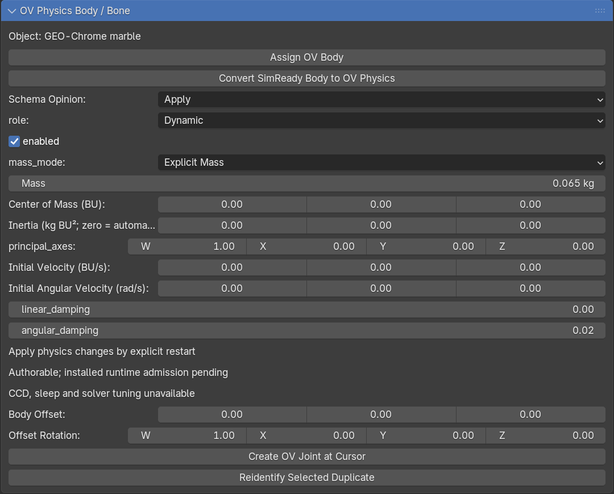
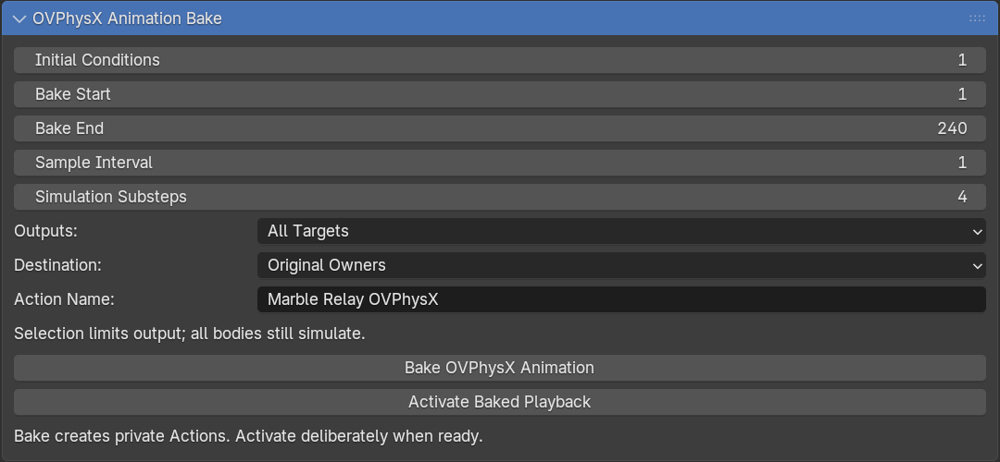
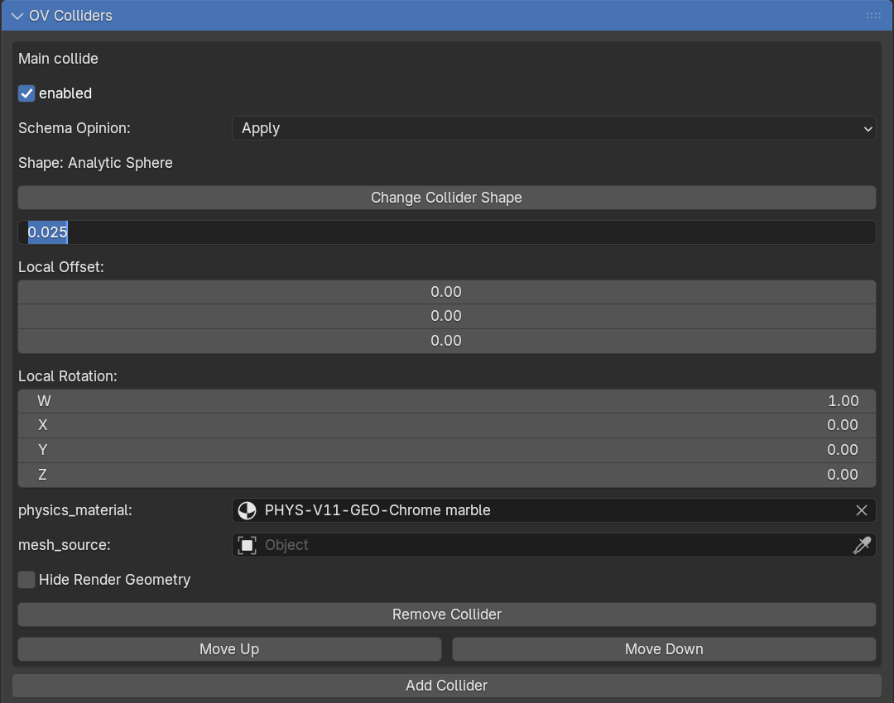
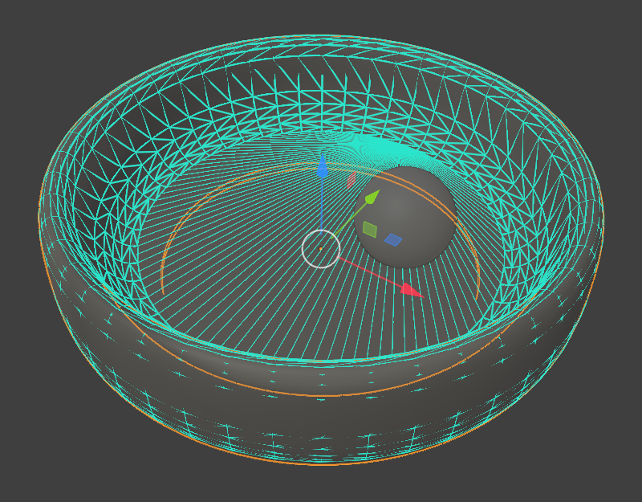
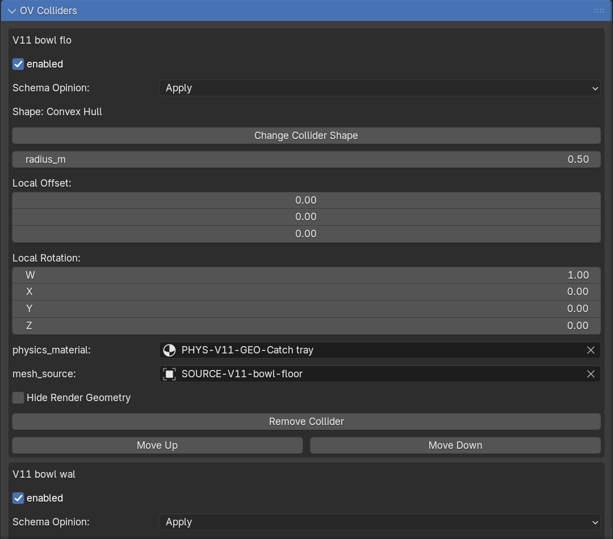
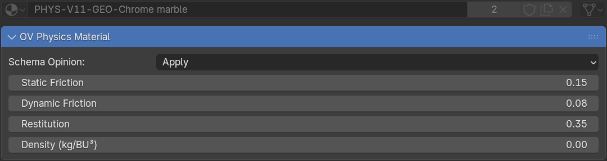
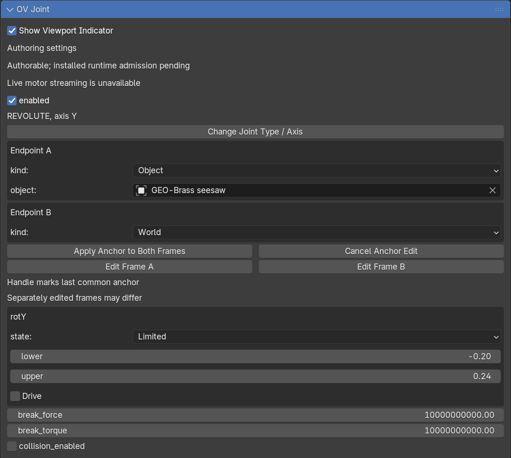

# Add physics and bake animation

Start with a cube falling onto a floor. Then try other collision shapes, adjust
friction and bounce, or connect objects with joints.

Use the add-on's **OV** panels, not Blender's standard Rigid Body controls.
[Install the add-on](install-guide.md) first. Physics uses the CPU by default;
`ovrtx` rendering uses the GPU.

## Find the controls

The **Properties editor** is usually on the right side of Blender. Select an
object, then open the relevant tab. You can also search for a panel by name.

| Task | Panel |
| --- | --- |
| Set how an object moves and its mass | **Physics → OV Physics Body / Bone** |
| Choose its collision shape | **Physics → OV Colliders** |
| Set friction and bounce | **Material → OV Physics Material** |
| Set gravity and show collision shapes | **Scene → OV Physics Scene** |
| Save simulated motion as animation | **Scene → ovphysx Animation Bake** |
| Connect two objects | **Physics → OV Joint**, with a joint selected |

## Make a falling cube

Use a new scene with Blender's default units. Save it before adding physics.

### 1. Make the prop and floor

1. Rename the default cube **Drop Cube** and move it to **Z = 3**.
2. Add another cube and rename it **Floor**.
3. Press **N** in the viewport to open the sidebar. Under **Item**, set the floor's
   **Dimensions** to **10 × 10 × 0.2** and its **Z Location** to **−0.1**.
4. Select each object and choose **Object → Apply → Scale**. Its scale should read **1, 1, 1**.
5. Set the Timeline to frames **1–120**. Keep the camera and light for rendering later.

### 2. Add bodies and colliders

A **body** controls how an object moves. A **collider** is the shape used to detect contact.

1. Select **Drop Cube**. Open **Physics Properties → OV Physics Body / Bone** and click **Assign OV Body**.
2. Set **role** to **Dynamic**, keep **enabled** checked, and set **Mass** to **1 kg**.
3. Open **OV Colliders**. The body already has a **Convex Hull** collider; keep it for this cube.
4. Select **Floor**, click **Assign OV Body**, and choose **Static**. Keep its default collider too.

| Body role | Behavior |
| --- | --- |
| **Dynamic** | Moves in response to gravity and collisions. |
| **Static** | Stays fixed, like a floor or wall. |
| **Kinematic** | Follows your animation and can push other objects. |

<figure><figcaption>Choose Dynamic for a moving object and enter its mass in kilograms.</figcaption></figure>

### 3. Set gravity and check the shapes

1. Open **Scene Properties → OV Physics Scene** and click **Apply Scene**.
2. Set **Gravity Direction** to **(0, 0, −1)** and **Gravity Magnitude** to **9.81**.
3. Enable **Physics Indicators** and **Collider Wires**. Keep **Show Overlays** enabled in the viewport.
4. Check that the cube's collider starts above the floor without overlapping it.

If **Selected Only** is enabled, select an object to see its collider. Hiding the
wires changes their display, not whether the objects collide.

### 4. Preview and reset

1. In **Render Properties**, choose **`ovrtx` Example** and switch the viewport to **Rendered** shading.
2. Return to frame **1** and play the Timeline. The cube should fall onto the floor.
3. Stop playback and return to frame **1** to reset.
4. After changing physics settings, restart playback from frame **1** to apply them.

Stop and reset before editing physics. To scrub saved motion backward and forward,
[bake the animation](#bake-and-render-the-motion) first.

## Bake and render the motion

**Baking** saves the simulation as animation keys you can play, edit and render.

1. Stop playback. Open **Scene Properties → ovphysx Animation Bake**.
2. For the cube exercise, set **Initial Conditions = 1**, **Bake Start = 1**,
   **Bake End = 120** and **Sample Interval = 1**. Leave simulation substeps at their default.
3. Choose **Outputs → All Targets** and **Destination → Original Owners**.
4. Click **Bake ovphysx Animation** and wait for completion. **Esc** cancels.
   Avoid saving, undoing or switching scenes while the bake runs.
5. Click **Activate Baked Playback**, then play or scrub the Timeline.
6. Save the `.blend` file. You can edit the keys in **Dope Sheet → Action Editor**.
7. Set up a camera and follow [Render an animation](render-guide.md#render-an-animation).

<figure><figcaption>Set Bake Start and Bake End to the range you want to save. Use 1–120 for the cube exercise.</figcaption></figure>

Use **Restore Previous Animation** before baking again or returning to live physics.
Baked motion can play without the physics runtime; `ovrtx` rendering still needs its runtime.

Bake selected objects or use an existing rig

**Selected Targets** saves keys only for selected objects, but all bodies still
participate in the simulation. If existing constraints, drivers or animation conflict
with the bake, use **Explicit Clean Outputs** to map the motion to separate objects
or bones. This copies transforms; it does not automatically retarget an IK rig.

## Choose a collision shape

Stop and reset the simulation, then open **OV Colliders → Change Collider Shape**.

| Shape | Use it for |
| --- | --- |
| **Box** | Blocks, floors and simple rectangular objects. |
| **Sphere** | Balls and other round objects. Set the radius in meters. |
| **Capsule** | Rounded cylinders. The cylinder runs along local Z; its height excludes the rounded ends. |
| **Convex Hull** | A solid outer envelope around a mesh. It cannot preserve holes or inward curves. |

Check the size and position of the collider after changing its shape. Use local
offsets and rotations to align it with the object.

<figure><figcaption>Match a sphere collider's radius to your object. Radius is measured in meters.</figcaption></figure>

### Hollow or complex objects

For a bowl or another hollow object, use several convex pieces for the floor and
walls. A single convex hull would fill the opening. **Add Collider** lets you combine
multiple collision shapes on one body; this is called a **compound collider**.

<figure><figcaption>Check that the collider wires leave the inside open.</figcaption></figure>

Set up multiple colliders

<figure><figcaption>Add each shape to the same body. For mesh-based shapes, select the corresponding source mesh.</figcaption></figure>

Check each collider's **Enabled** setting. **Hide Render Geometry** hides its visible
mesh without turning off collisions.

## Adjust friction and bounce

1. Stop and reset the simulation. Select an object with an active Blender material.
2. Open **Material Properties → OV Physics Material** and set **Schema Opinion → Apply**.
3. Adjust the contact settings below.
4. In **OV Colliders**, assign that material to the collider's **physics_material** field.
5. Restart from frame **1** and compare the motion.

| Setting | Effect |
| --- | --- |
| **Static Friction** | Resistance to starting a slide. |
| **Dynamic Friction** | Resistance while sliding. |
| **Restitution** | Bounce: lower values reduce it; higher values increase it. |

<figure><figcaption>Adjust friction and bounce here, then assign the material to the collider.</figcaption></figure>

Assign the physics material to the collider even if the object already uses it for
rendering. In **OV Physics Body / Bone**, **linear_damping** slows movement and
**angular_damping** slows rotation. Lower damping lets motion continue longer.

## Add a joint or a bone body

A **joint** connects bodies and limits how they move. A **Revolute** joint acts like a hinge.

1. Give an object a body and collider. Place the **3D Cursor** at the hinge location.
2. Select that body and click **Create OV Joint at Cursor**.
3. Select the new joint object and open **Physics Properties → OV Joint**.
4. Use **Change Joint Type / Axis** to choose **Revolute** and the rotation axis.
5. If you move the joint, click **Apply Anchor to Both Frames** before previewing or baking.
6. Restart from frame **1**. Add rotation limits after the hinge moves correctly.

<figure><figcaption>Choose the connected objects under Endpoints. Use World to attach one side to a fixed location.</figcaption></figure>

To connect two bodies, select both before creating the joint. The active object
becomes **Endpoint A**. Other joint types include **Fixed**, **Prismatic** (sliding)
and **D6** (configurable movement and rotation).

Use a bone instead of an object

Select an armature, enter **Pose Mode**, select a bone, and use **OV Physics Body / Bone**.
Add its collider explicitly. For a joint endpoint, choose the armature and bone,
then use **Bind Selected Bone Name**. Resolve conflicting animation, constraints
or drivers before running physics. Use local, editable objects and armatures.

CPU physics is the default for this workflow. GPU joints are limited to world
attachments with unrotated local joint frames. Live motor-target changes, acceleration
drives, cloth, fluids and deformable bodies are unsupported. Animated bone transforms
can drive Blender's skin deformation, but `ovrtx` skinned rendering is unsupported.

## Units

| Field | Unit |
| --- | --- |
| Mass | Kilograms |
| Density | Kilograms per cubic Blender unit |
| Body/collider offsets and Box Dimensions | Blender units |
| Sphere/capsule radius and capsule cylinder height | Meters, even in a centimeter scene |
| Initial linear/angular velocity | Blender units per second / radians per second |
| Gravity magnitude | Meters per second squared |

Leave all **diagonal_inertia** values at zero to calculate inertia automatically.

## Bring an existing SimReady prop

Select the mesh, stop and reset physics, then choose **Physics Properties →
OV Physics Body / Bone → Convert SimReady Body to OV Physics**. After conversion,
edit the object's physics in the OV panels.

Some collider layouts cannot be converted. Read the error if conversion fails.
Blender constraints are not automatically converted into OV joints.

## Troubleshooting

| Problem | What to check |
| --- | --- |
| Object does not fall | Use **Dynamic**, enable the body and collider, apply gravity, and restart from frame 1. |
| Object falls through the floor | Give the floor a **Static** body and collider. Check collider size and placement. |
| Physics controls are disabled | Stop and reset playback. Use **Restore Previous Animation** if a bake is active. |
| Motion looks wrong | Show collider wires and check overlap, scale, friction and damping. |
| Bake fails | Apply pending joint anchors and resolve conflicting animation or output mappings. |
| Simulation reports an unsupported setting | Read the first error in the panel and check the [platform and device limits](support-platforms.md). |
