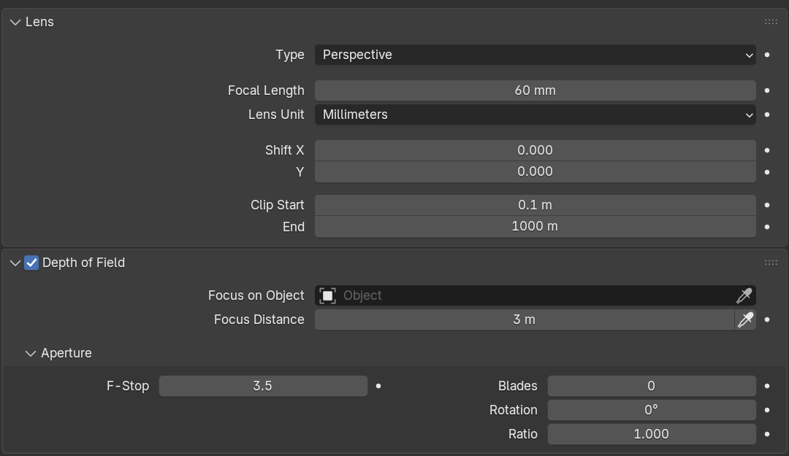

# Render your first scene

Use `ovrtx` to preview your scene, render a camera view and save an image.
[Install the add-on](install-guide.md#4-verify-in-blender) before you begin.

## 1. Open a scene

Open a demo scene or create one with an object, a light and a camera. Blender's
default scene includes all three. Save a working copy before making changes.

For a repeatable reference render, follow the [Junk Shop verification workload](verification-workload.md).
It specifies the scene download, camera, resolution and sample count.

## 2. Preview the scene

1. In **Render Properties**, choose **Render Engine → `ovrtx` Example**.
2. Switch the 3D Viewport to **Rendered** shading.
3. Wait for the image to appear. The first render can take longer while the renderer starts.
4. Orbit the view. With **Sync Blender View** enabled, the rendered view follows you.
5. Try moving an object or changing a light. Undo the change if you want to keep the original scene.

If the image stays blank, read **Render Properties → `ovrtx` Example → `ovrtx` Session**.

## 3. Render and save a still

1. Press **Numpad 0**, or choose **View → Cameras → Active Camera**, to check the camera view.
2. In **Output Properties**, set the resolution. Use a smaller size for a quick first render.
3. Press **F12**, or choose **Render → Render Image**.
4. When the render finishes, choose **Image → Save As** in the Render Result window.

Save your `.blend` file separately. Saving the scene does not save the rendered image.

### Adjust the camera

Select the camera and open **Camera Properties**. Change **Focal Length** to adjust
how much of the scene fits in the frame.

For a blurred background, enable **Depth of Field**. Choose a **Focus on Object**
target or set **Focus Distance**. A lower **F-Stop** gives stronger blur.

<figure><figcaption>Set the focus on your subject, then adjust F-Stop to control background blur.</figcaption></figure>

## Render settings

Start with the defaults. Change one setting at a time so you can see its effect.

| Setting in Render Properties | When to change it |
| --- | --- |
| **Minimum Samples / Maximum Samples** | Increase the sample budget to reduce noise. Higher values can take longer. |
| **Max Bounces** | Allow light to reflect or pass through more surfaces. |
| **Max Specular and Transmission Bounces** | Adjust the limit for reflections and transparent materials. |
| **Firefly Filter** | Reduce isolated bright specks. |
| **Final Render Anti-Aliasing** | Smooth jagged edges. Use **1×** for speed or the default **2×2** for better edges. |
| **Viewport Anti-Aliasing** | Smooth viewport edges. The default **1×** keeps navigation faster. |
| **DLSS Super-Resolution** | Switch between the default and Performance settings. Unchecking it does not fully disable DLSS in this release. |

**2×2** renders at twice the width and height, then reduces the image to your output
size. It processes four times as many pixels. More samples alone may not fix jagged edges.

## Color management and HDR output

Open **Render Properties → `ovrtx` Example → Color Management → Color Presentation**.

| Mode | Use it for |
| --- | --- |
| **LDR display passthrough** | An image with its display colors already applied. Blender's additional display adjustments are disabled. |
| **Scene-linear HDR** | Adjusting the image with Blender's **View Transform**, **Look**, **Exposure** and **Gamma**, or saving an HDR file for compositing. |

To save HDR, select **Scene-linear HDR**, render with **F12**, then save as **OpenEXR**.
This retains a wider brightness range for later editing.

This release outputs one LDR or HDR image at a time. Transparent backgrounds and
extra passes such as depth and normals are unavailable. Some Blender shaders and
volumes are unsupported, so materials may look different from Cycles or EEVEE.

## Render an animation

1. If the motion uses physics, [bake it first](physics-guide.md#bake-and-render-the-motion).
2. Set the frame range and frame rate. Check the active camera and output resolution.
3. In **Output Properties**, choose an output folder and **PNG** or **OpenEXR** image sequence.
4. Render one frame with **F12** to check the result.
5. Choose **Render → Render Animation**.

An image sequence keeps completed frames if rendering stops. Assemble the frames
into a movie using Blender's Video Sequencer after rendering finishes.

## Troubleshooting

| Problem | What to do |
| --- | --- |
| F12 shows a different view | Check the active camera with **Numpad 0** and confirm the output aspect ratio. |
| Colors or brightness look wrong | Check **Color Presentation** and Blender's display settings. |
| A material looks different from Cycles | Try a simpler material. Not all Blender shader nodes are supported. |
| Edges are jagged | Increase **Final Render Anti-Aliasing** or **Viewport Anti-Aliasing**. |
| An edit does not appear | Read **ovrtx Session**. The change may require a restart or may be unsupported. |
| Rendering stops updating | Try **Reconnect ovrtx Session**, then **Restart ovrtx Worker**. |

For a persistent error, keep its message and the reported `worker.log` and `ovrtx.log`
files. **Open ovrtx Logs** is available when file logging is enabled. Remove private
paths and scene details before sharing logs.
