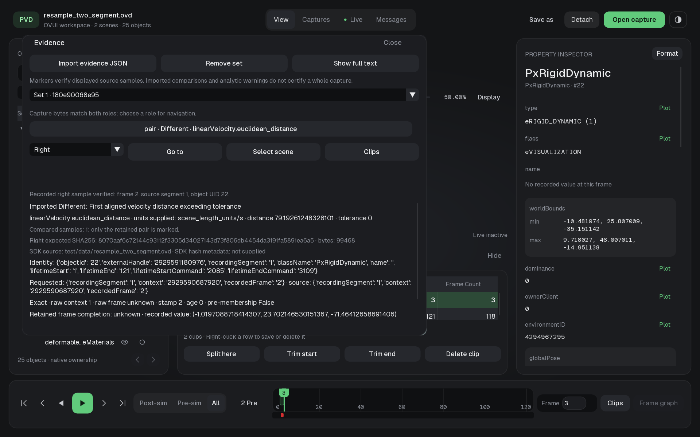
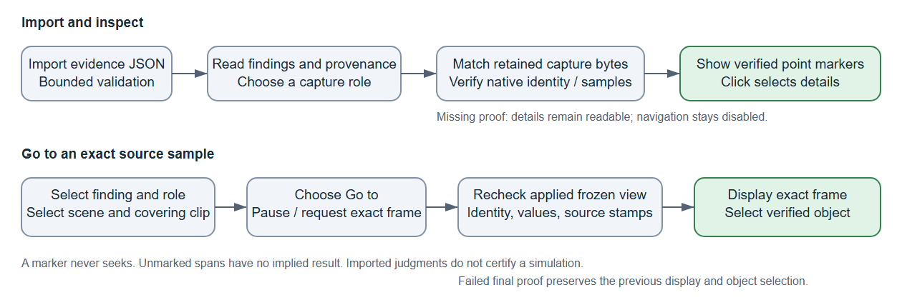

# Evidence JSON

The viewer reads `physx.ovd.inspection-evidence` versions 1 and 2 without changing
the SDK record. Version 1 contains a representative velocity pair; version 2 also
supports typed vector and transform comparisons and pair-specific completion.
`Different` reports a measured difference. `Equal` describes retained samples,
not a complete simulation or a tested interval. Missing, carried, incomparable,
inconclusive and replaced text remain visible. Imported units and tolerances
are supplied by the producer; the viewer does not silently convert units.

Bare SDK records usually have no capture hash and remain available for inspection.
Neither a path, object handle, source UID nor viewer session key identifies bytes.
A recognized bare hash uses `sha256:<64 lowercase hexadecimal characters>`.
The producer's `viewerImportSupported:false` is retained as historical metadata.

The viewer envelope has format `ovdnext.timeline-evidence`, version `1`, `captures`
and `findings`; optional `observations` and explanatory `provenance` are supported.
Capture roles are `left` and optionally `right`, with `sha256` and decimal-string
`byteLength`. Comparison findings contain `id`, `kind:"comparison"` and the
unchanged SDK object in `evidence`; both roles are required. A nested nonempty
SDK hash must agree with its envelope binding. Optional `phaseMapping` describes
supplied `sdk-pre-post` mapping; frame parity alone never establishes phase.

Scalar-window findings enumerate evaluated points, supporting observations,
their source frames, assumptions and an imported measure. They supply no tested
band between points. The initial supported analytic name is
`mechanicalEnergy.relativeHandoverChange`, in `fraction` with reference `0`;
point values and energy components are joules. Other analytic names remain
readable without verified navigation. `producer-log` and `native-recorded`
origins remain distinct. Unknown sources are null, never fabricated frame zero.
Static initialization requires an actual matching stored initialization sample;
dynamic pose and velocities require exact known source frames.

For this energy metric, supporting `native-recorded` observations use `mass` in
`kg`, `massSpaceInertiaTensor` in `kg*m^2`, `cMassLocalPose` in `m`, and scene
`gravity` in `m/s^2`. Point observations use `globalPose` in `m`, `linearVelocity`
in `m/s`, and `angularVelocity` in `rad/s`. A separate `producer-log` observation
named `energyReferencePosition`, in `m`, declares the analytic reference position;
it is not a captured physical fact. The consumer checks COM/mass-frame energy
against the recorded values and a positive-gain threshold. It does not certify
handover selection, unit assumptions, absent external work or solver correctness.

Parsing accepts strict UTF-8 without BOM: at most 4 MiB, nesting depth 32,
50,000 nodes, 1 MiB aggregate text, 64 KiB per string, 256 findings,
8,192 observation references and 4,096 evaluated scalar points. Duplicate keys,
nonfinite numbers, unsupported versions/enums and unresolved references reject
the import. Source IDs/counters are canonical uint64 decimal strings; offsets
are canonical int64 strings. Booleans are not numbers. Additional bounded SDK
fields are retained; envelope records reject unknown keys.

Navigation additionally requires the actual retained OVD payload, original
object/scene/segment identity, a proved frame domain, lifetime containment and
matching stored values/source stamps. OVD snapshots are bounded to 512 MiB;
larger captures retain ordinary playback with evidence inspection available.
Pathless and live displays need an explicit save and open before binding.
When both roles match the same bytes, the user must select a side. Scene and clip
selection remain explicit: Go to never clamps into a different frame or creates
a clip. Native lifetime containment governs navigation; SDK lifetime fields are
retained for inspection because their conventions may differ.

Open a capture, then choose **Import evidence JSON** in the application menu.
The Evidence window lists imported sets and findings. Select a finding and choose
its capture role when both roles match. A marker selects details without moving
the playhead. Select the indicated scene and a clip covering the exact frame,
then choose **Go to** to pause there and select the verified object. A disabled
button explains which prerequisite is missing. The ordinary ruler still seeks
independently; unmarked spans have no implied evidence status.

Imports run asynchronously and retain at most four sets. A failed import leaves
the previous sets intact. **Remove set** releases one set; sets are session-local
and are not written into captures or saved workspace preferences. Reopening a
capture rechecks its content and native source samples before enabling navigation.
