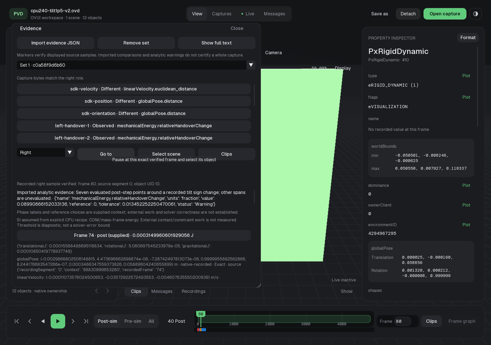
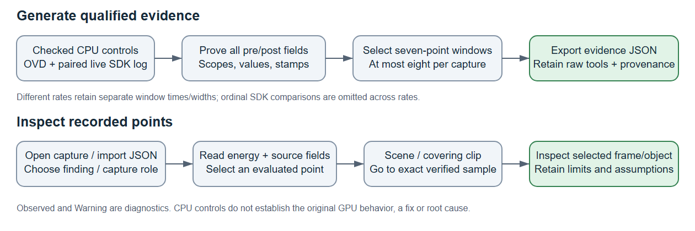

# CPU control evidence walkthrough

This is an independently authored CPU scene and initial-condition control for
the parameters in [PhysX issue 584](https://github.com/NVIDIA-Omniverse/PhysX/issues/584).
It demonstrates measured evidence inspection. The reporter's GPU workload has
not been reproduced or fixed here, and these controls establish no root cause.
The attempted GPU build lacked nvcc; the unchanged reporter program also failed
to link its CUDA manager against the CPU-only SDK and did not run.





Build and run the [bounded recorder](../examples/evidence_timeline/README.md).
Use the existing OvdNext source environment and its built native module. Supply
an explicitly built SDK `ovd-inspect` executable with evidence v1/v2 and typed
vector/transform support. The exercised inspector was built from
`NVIDIA-Omniverse/physx-internal` revision
`8972c3c72dff9a828e2f61510e3462c5151c0bdc` (SDK 5.13.0); it reads the separate
5.12.0 CPU captures. Building that tool requires its existing source access.
There is no automatic download, dependency installation or cross-OS recorder
launch. Run all tools on the host their executable was built for.

```sh
python tools/evidence_showcase.py \
  --left control-runs/cpu240-3.ovd --right control-runs/cpu240-1p5.ovd \
  --left-log control-runs/cpu240-3.json --right-log control-runs/cpu240-1p5.json \
  --inspector /path/to/ovd-inspect --native-root /path/to/native/python \
  --output control-runs/initial-conditions.evidence.json
python tools/evidence_showcase.py \
  --left control-runs/cpu240-3.ovd --right control-runs/cpu480-3.ovd \
  --left-log control-runs/cpu240-3.json --right-log control-runs/cpu480-3.json \
  --inspector /path/to/ovd-inspect --native-root /path/to/native/python \
  --output control-runs/rate-sensitivity.evidence.json
```

Outputs and the corresponding `.assets` directories must be new. Assets retain
the exact capture/log copies, original inspector stdout/stderr, argv/exit/tool
hash records and a final generation receipt. A failed generation leaves an
explicit incomplete receipt; it supplies no usable evidence verdict. Successful
generation checks the envelope through the same native binding used by the UI.

The generator discovers each original actor UID, external handle, scene context
and segment separately. It proves native values for every logged pre/post pose,
velocity, angular velocity, mass, inertia, COM and gravity. It checks pre/post source
stamps for pose and both velocities on every step; setup stamps for mass, inertia,
COM and gravity are retained and checked by consumer binding for exported windows.
For the exercised recordings, pre frame `2n-1` carries prior dynamic samples and
post frame `2n` contains exact dynamic writes. This relationship is checked for
every step with complete monotonic/consecutive scopes; parity alone is rejected.
Mass/inertia/COM initialization at stamp 0 and gravity at a known recorded frame
remain distinguishable. Existing SDK transform/gravity inspections preserve
original object/scene identities; no scalar CLI extension is required.

Equal-rate captures receive unchanged SDK velocity, position and orientation
comparison records with independently discovered selectors. Their different
initial tilts are controls, so a difference is expected. Different-rate captures
receive their own scalar windows; the tool omits SDK ordinal comparisons because
equal frame numbers would represent different physical times.

Open the +3°/240 Hz capture in OvdNext and choose **Import evidence JSON**. Import
the initial-condition envelope, select `left-handover-1`, choose **Left**, and
inspect the seven evaluated points. Selecting a point changes details; **Go to**
pauses at its exact frame and selects the verified body. Choose the indicated
scene and a covering clip explicitly when needed. Reopen the +1.5° capture;
the same set binds its **Right** role. Select a right-hand finding and inspect
its own values. Unmarked spans and omitted windows have no implied result.

Energy uses world COM `globalPose * cMassLocalPose`, COM translational kinetic
energy, angular energy in the composed mass frame, and gravitational potential
`-m*g·(COM-reference)`. The explicit analytic reference is (0,0,height/2), in
metres. Native setup/dynamic inputs are distinguished from this supplied choice.
The calculation assumes SI units; it does not measure external contact or
constraint work. Missing or invalid inputs remain inconclusive.

A candidate is a recorded tilt sign change with absolute tilt below 1°. The
seven-point window retains three post-step points before and after it. Its
before-energy must exceed 10% of the first post-step energy and ten times its
roundoff estimate. The absolute gain threshold is
`max(0.01*abs(Ebefore), roundoffBefore+roundoffAfter)`, where
`roundoff = 64*float32_epsilon*(abs(Tlinear)+abs(Tangular)+abs(Vabsolute)+abs(Vreference))`.
Divide by positive `Ebefore` for the fraction threshold. A positive gain above
that threshold is **Warning**; other supported measurements are **Observed**.
These are explicit engineering diagnostics, with no pass/fail solver verdict.

The first eight eligible windows per capture are exported at most. Excluded
crossings, additional eligible windows and their selection counts stay in
provenance. At 240 Hz, ±3 steps means approximately ±12.5 ms; at 480 Hz it means
approximately ±6.25 ms. The sensitivity comparison changes both timestep and
physical window width, so it cannot isolate a single numerical cause.

One dated local run (Ubuntu 22.04/GCC 11.4.0, exact checked SDK above, ten simulated
seconds each) produced the following diagnostic observations. These values are
not acceptance thresholds for a different machine or build.

| CPU control | Verified pre/post field samples | Eligible / exported windows | Excluded for small reference energy | Median exported relative change | Gain warnings |
| --- | ---: | ---: | ---: | ---: | ---: |
| 240 Hz, +3° | 33,600 | 6 / 6 | 5 | -27.80% | 0 |
| 240 Hz, +1.5° | 33,600 | 5 / 5 | 3 | -39.11% | 1 |
| 480 Hz, +3° | 67,200 | 9 / 8 | 13 | -16.05% | 0 |

In that run, `right-handover-2` in the initial-condition set retained frames
74,76,78,80,82,84,86 and measured +8.9907%, above its 1.3452% diagnostic threshold.
Inspect those recorded points and assumptions directly. Timestep sensitivity,
unmeasured contact/constraint work and floating-point limits remain material;
this warning establishes neither the original GPU behavior nor a solver defect.

Actual Windows and Linux walkthroughs cover imported scalar points, explicit roles,
exact frame/object navigation, capture reopening and the retained warning.
Required CI and portable-package checks retain their own validation evidence.
Full captures/logs and operational review records remain local.
