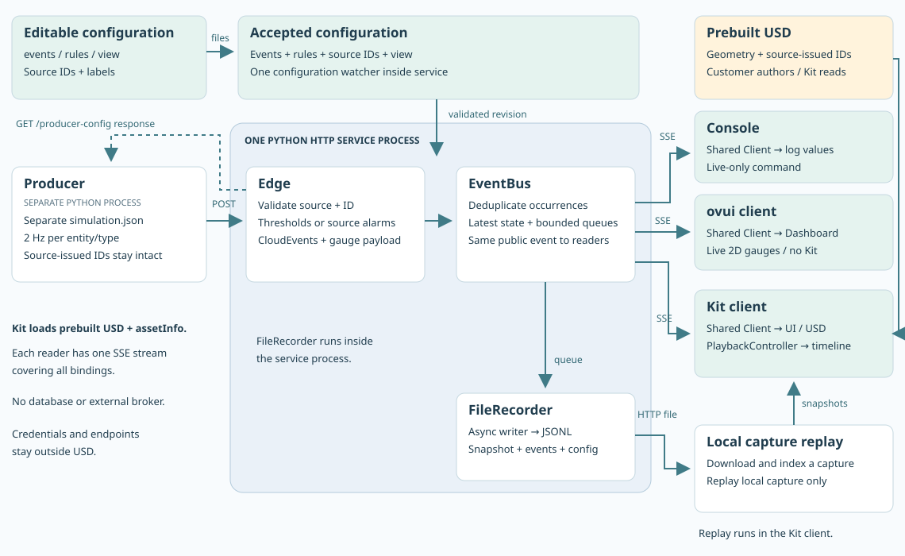
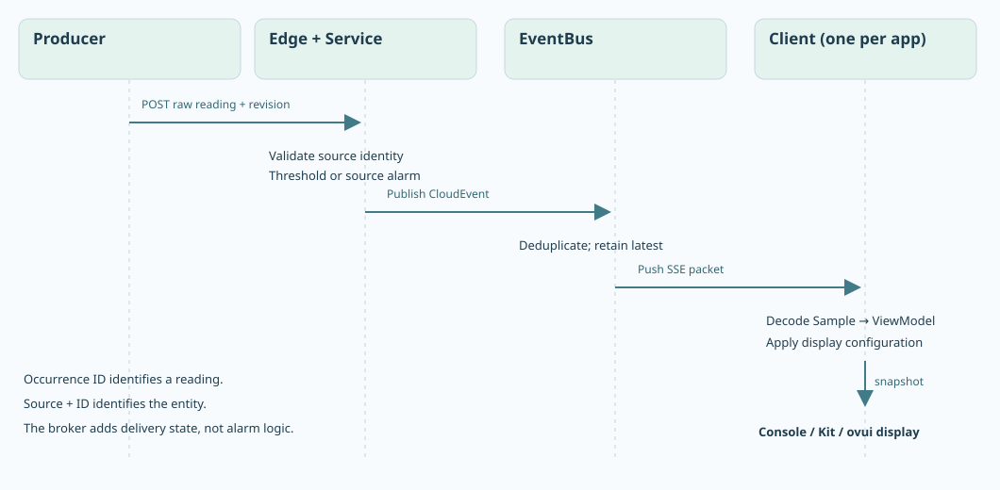
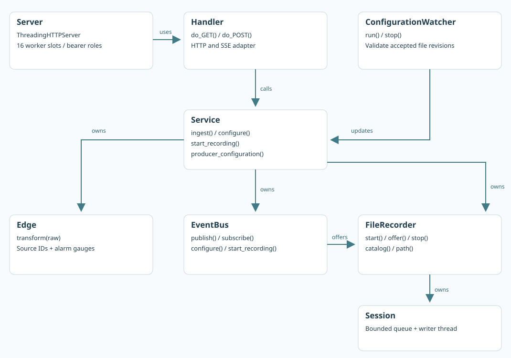

# Architecture: the live half of composable bindings

This sample implements the **live half** of the [Composable Bindings: Simplified System Integration white paper](https://aka.ms/ComposableBindings): producers supply operational data, the service enriches it, and independent consumers share the result. Source identity alongside the USD namespace is a separate idea described in [OpenUSD-proposals#105](https://github.com/PixarAnimationStudios/OpenUSD-proposals/pull/105). The sample uses a dictionary convention inspired by that proposal, not a standardized OpenUSD binding schema.

Historical information belongs to the issuing source system. A history integration would resolve the system and its source-issued ID from a prim, then query that source's historian/API for the ID and a time range. Endpoints and credentials belong in deployment configuration. **This sample does not implement that source-history lookup.** Kit's Capture replay mode only replays this sample's own recording of the live stream, including any declared gaps. It is a debugging/demo feature, not the history half of the pattern.

## Runtime entities and boundaries

| Entity | Implementation | Responsibility |
| --- | --- | --- |
| Synthetic source | [simulator.py](../../source/composable_bindings/reference/simulator.py), [simulation.py](../../source/composable_bindings/reference/simulation.py), [aggregation.py](../../source/composable_bindings/reference/aggregation.py) | Owns `factory_simulator` IDs, waves and same-instant line sums. Posts readings using `simulation.json`. |
| Second source adapter | [json_source.py](../../source/composable_bindings/reference/json_source.py) | Maps a JSON Lines source record to the ingestion contract, preserving source IDs, occurrence IDs, timestamps and source-owned alarms. |
| HTTP adapter | [transport.py](../../source/composable_bindings/reference/transport.py) | Authenticates ingestion and readers; delivers a persistent SSE stream per consumer. |
| Service and edge | [service.py](../../source/composable_bindings/reference/service.py) | Validate against `events.json`, preserve source identity, evaluate configured thresholds or forward declared source alarms, and encode the public event. No simulation dependency. |
| EventBus | `EventBus` in `service.py` | Deduplicate, maintain latest values, publish atomic catalog/view/value snapshots, and fan out live events. |
| Configuration | [composition.py](../../source/composable_bindings/reference/composition.py), [reload.py](../../source/composable_bindings/reference/reload.py) | Compose declarations and additions; publish validated revisions and keep the last valid revision after rejection. |
| Shared consumer | `Client`, `ViewModel`, `PlaybackController` | Decode events, format displays and optionally replay local captures. No rendering dependencies. |
| Console / ovui / Kit | `source/clients/` | Present the shared result. Kit additionally resolves scene source IDs, selection and capture controls. |
| FileRecorder | [recording.py](../../source/composable_bindings/reference/recording.py) | Capture public packets and configuration snapshots asynchronously as JSON Lines. |

The default produces six events/second: two machine events and one line event, each at 2 Hz. Adding voltage adds four events/second. No client computes alarms or line totals.

## Follow a reading

1. A source adapter supplies `source`, `source_id`, `event_id`, `event_type`, observation `time`, `values`, optional `alarms`, and the accepted `config_revision`. The simulator invents only synthetic readings and occurrence IDs; its asset IDs are its own stable identifiers.
2. The edge checks the declared source, asset, event type and metrics. `config/bindings.json` supplies labels for those existing source IDs; it does not mint aliases. The edge computes strict `above` rules or forwards boolean source alarms, retaining the occurrence ID and time.
3. A public CloudEvent uses `source: urn:example:source:<system>` and `subject: <source-issued ID>`. Resource attributes `source.name` and `source.id` carry the same identity. Alarm gauges identify their origin (`rule: above` with a threshold, or `rule: source` with the issuing system).
4. The bus delivers an initial snapshot and subsequent live packets. Shared Python decodes and formats them; each application draws or logs the same value, unit and alarm result.

See [raw input](../../artifacts/reference/example-ingest.json) and [its emitted event](../../artifacts/reference/example-public-event.json). The outer envelope follows CloudEvents conventions; `data.resourceMetrics[].scopeMetrics[].metrics[]` is a limited, manually implemented OTLP-shaped gauge profile (`urn:example:composable:metrics:2`). There is no OpenTelemetry SDK/Collector or standard OTLP receiver. The SSE wrapper and configuration snapshots are sample contracts.

A source-owned alarm is declared with `alarm: source` on its metric. Its input is `alarms[metric] = true`, `false` or `null`; absence means unknown. It cannot also have an edge threshold. A true alarm stays visible even without a numeric measurement. A missing expected alarm displays UNKNOWN, rather than an assumed normal state. Threshold policies remain deliberately limited to strict numeric greater-than.

## Identity and scene lookup

`(source, id)` is the identity everywhere: declaration, catalog, client cache, retained bus state and capture replay. The same ID text from two systems does not collide. Occurrence IDs identify individual readings and are deduplicated within the issuing system; adapters must provide system-wide unique occurrence IDs, stable across retries.

Assembly prims carry `assetInfo.sourceIds.<source>.id`, for example `sourceIds.factory_simulator.id = "mock-controller-1"`. These are the same IDs recognized by that source, not scene paths or aliases created by a crosswalk. Kit reads all source dictionaries and matches both the system and ID. Multiple prim placements can refer to one source entity. A prim with an ID absent from the active catalog gets a visible **UNMATCHED** entry and selection button; a prim without an ID is unbound. Matching is recomputed after scene or catalog changes.

Authoring, renaming, reparenting and asset replacement remain the publisher's responsibility. See [USD source-ID authoring](USD_BINDINGS.md). Credentials, source endpoints and values stay outside the portable scene. Source IDs may be sensitive; they are not access-control tokens and this version does not hide them behind aliases.

## What is declarative, and what can be replaced?

| Question / reference | Implemented behavior | Boundary |
| --- | --- | --- |
| Separate scene namespace and external identity — [OpenUSD-proposals#105](https://github.com/PixarAnimationStudios/OpenUSD-proposals/pull/105) | Source-issued IDs survive namespace edits when metadata is preserved. | The dictionary spelling is a local convention; full authoring lifecycle automation is not implemented. |
| Enrich operational data before visualization — Composable Bindings white paper | Producer computes line totals; service evaluates thresholds or preserves source alarms. | Only numeric gauges, strict `above` rules and the simulator's sum are implemented. |
| Is policy declarative? | Thresholds live in `rules.json`; `alarm: source` explicitly delegates an alarm decision to the source. | New rule operators need implementation; source-specific policy remains at the source. |
| Can a new consumer subscribe without transformation logic? | Yes: snapshot + events provide the shared contract, catalog and display configuration. | New renderers need presentation code, not new enrichment. |
| Can a different OT system be added without changing enrichment? | Yes: declare assets/events/metrics and use or adapt the [second-source adapter](SOURCES.md). No simulated metric is required. | A different wire protocol or nontrivial value conversion needs source-adapter code; metric names are globally unique in this sample. |
| Can history be fetched through the source ID? | The identity is preserved for that lookup. | No source-history resolver/API exists here. Local capture replay is not source history. |

## Scaling and production boundaries

`Service(config, bindings, bus=...)` is the bus injection point. A bare Kafka or NATS publisher is insufficient: new and reconnecting consumers need latest values **and** the matching catalog/view before live updates. The [replacement bus contract](BUS.md) specifies snapshot consistency, retained state, deduplication, ordering, gaps and capture hooks, with an outline for a broker-backed implementation.

This implementation limits itself to 64 assets, 8 event definitions, 16 metrics/event, 12 subscribers, 128 queued packets/subscriber and 16 HTTP workers. Network reads, formatting, recording and replay indexing use workers. UI/USD updates stay on the application thread. A slow reader receives an explicit latest-state reset; missed transitions are not reconstructed. The in-memory bus is not durable, and adapters have bounded retries rather than a persistent outbox. Captures have a 4,096-packet queue and 64 MiB cap; incomplete files are rejected.

Production deployments need authenticated TLS transports, source-scoped ingest credentials, per-entity delivery authorization, a durable source outbox, separate capture-control permission and protected capture storage. The local demo has loopback bearer roles only. Retained broker state supports live initialization; authoritative historical queries still go to the source through its ID.
