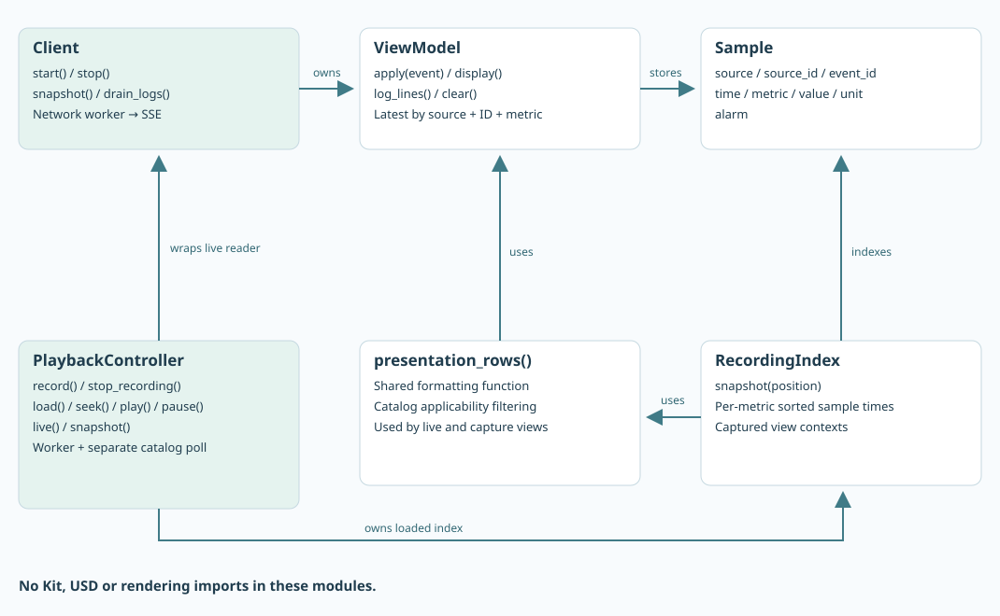

# Shared Python client

`Client` is the reusable consumer used by the console, Kit and ovui applications. It handles connection, decoding, latest-value state and presentation formatting. It imports only Python’s standard library and other shared modules.



The application folders are `source/clients/console_client/`, `source/clients/ovui_client/`, and `source/clients/extensions/`. The first two have module entry points; Kit loads its extension through the launchers. Shared networking, decoding and replay stay in `source/composable_bindings/reference/`.

## A minimal consumer

Run from the project root; no package installation is needed:

```python
from pathlib import Path
import sys
import time
sys.path.insert(0, "source")
from composable_bindings.reference.client import Client

client = Client(Path(".runtime/default/client.json")).start()
try:
    for _ in range(50):
        for line in client.drain_logs():
            print(line)
        snapshot = client.snapshot()
        # snapshot["rows"]: binding + configured displays
        # each display: spec, text, state, fraction, Sample
        time.sleep(0.1)
finally:
    client.stop()
```

`start()` starts one network worker. It reads the catalog and opens SSE, then rebuilds presentation rows after accepted packets. `snapshot()` returns an immutable-by-convention view of the latest presentation; callers must not modify its rows. `drain_logs()` returns and clears pending formatted lines. `stop()` ends the worker. Credentials are reread on reconnect.

`ViewModel.apply()` rejects older observations and repeated occurrence IDs for a metric. `Sample` carries `source`, `source_id`, event ID, observation time, metric, value, unit, quality, alarm and whether an alarm is expected. Its `identity` property is the `(source, source_id)` pair; caches and replay indexes use both components. `presentation_rows()` filters display specs by each binding’s catalog metrics, so line throughput appears on the line only.

A row can also contain `display_color` with its mode, shared alarm state, selected RGB and unknown-value RGB. Gradient mode interpolates the measured value across the configured range; state mode selects an alarm-state color. Kit applies that presentation to the bound geometry; other clients may ignore it. Live snapshots mark a lost connection with `stale: true`, allowing Kit to show unknown colors without changing recorded alarm decisions.

## Optional local capture and replay API

This is not source history. Historical data would be queried from the issuing source using its ID and a time range; the sample has no such resolver or endpoint.

```python
from composable_bindings.reference.playback import PlaybackController
replay = PlaybackController(client, Path(".runtime/default/client.json")).start()
# Controls enqueue asynchronous commands:
replay.record()             # service-owned capture of all bindings
replay.stop_recording()     # finalize file; inspect timeline before loading
replay.load()               # newest capture; or load(recording_id)
replay.seek(5.0)            # seconds since capture start; pauses playback
replay.play()
replay.pause()
replay.live()
state = replay.snapshot()   # presentation plus state["timeline"]
replay.stop()              # stop replay workers before stopping client
```

The control calls above illustrate the API, not a timed demo script: inspect `snapshot()["timeline"]` for `mode`, `busy`, `active`, `recordings`, `position`, `duration`, `playing` and `error` between actions. Kit does this continuously. Console and ovui remain live-only; neither exposes playback controls.

The live client keeps receiving while the replay controller presents a separate recorded frame. The controller has a playback/control worker and a separate catalog-polling worker, so catalog delays do not stall an already loaded seek. A `RecordingIndex` stores sample time arrays and recorded view contexts. Backward seeks reuse original alarms and configuration rather than evaluating today’s thresholds.

## HTTP API for another language or client

All requests use `Authorization: Bearer …` from the relevant generated credentials file. The current adapter accepts loopback HTTP only.

| Method and path | Role | Response or purpose |
| --- | --- | --- |
| `GET /producer-config` | Ingest | Accepted event contract in `definitions` and its `revision`; no thresholds or simulation settings. |
| `POST /ingest` | Ingest | Raw source event; 202 accepted, 400 invalid, 409 stale revision. |
| `GET /catalog` | Reader | Source/ID pairs, labels, applicable metrics and profile. |
| `GET /events` | Reader | Persistent SSE; `data:` contains an event or snapshot packet. |
| `POST /recordings/start` | Reader | Start the service’s one active capture, seeded with its current snapshot. |
| `POST /recordings/stop` | Reader | Drain and finalize that capture. |
| `GET /recordings` | Reader | Finished files, active capture metadata and errors. |
| `GET /recordings/<id>` | Reader | Finished JSONL file; IDs are generated names, not arbitrary paths. |

A stream event packet contains `kind`, `epoch`, `sequence` and `event`; a snapshot contains `events`, `catalog`, `view`, `config_revision` and its reset reason. Handle snapshots as replacement state. There is no durable cursor/catch-up protocol on SSE. A completed local capture supports replay of what this sample recorded, not a query of source history.

## Extending or replacing it

Use `Client` for a new reader that needs the current display contract. Use `decode()` and `Sample` for an application with its own presentation model. Replace the transport adapter when adding authenticated remote delivery; keep decoding and rendering independent. A broker adapter must supply the same consistent catalog/view/latest-value initialization and live transition; see the [replacement bus contract](BUS.md).

Source: [client.py](../../source/composable_bindings/reference/client.py), [model.py](../../source/composable_bindings/reference/model.py), [playback.py](../../source/composable_bindings/reference/playback.py).
