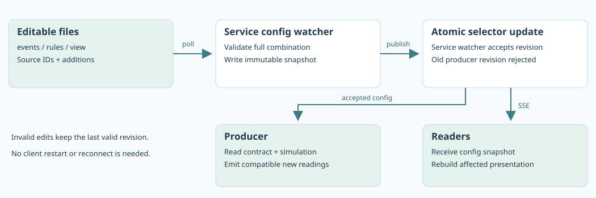

# Configuration: source contracts and simulation are separate

The ingestion contract declares what a source may send. Simulation is one producer of that contract and has its own optional configuration. The service never requires an event metric to be simulated or aggregated.

| File | Defines | Owner |
| --- | --- | --- |
| `events.json` | Source systems and their IDs; event types, applicable assets, metric names/units and optional source alarm ownership | Source integration contract |
| `simulation.json` | Optional wave parameters, emission intervals and same-instant sums for `factory_simulator` | Synthetic producer |
| `rules.json` | Strict `above` thresholds for metrics whose alarms are evaluated at the edge | Edge/domain policy |
| `view.json` | Displays, ranges, precision, placement and per-source-ID gauge offsets | Presentation |
| `config/bindings.json` | Existing source/ID pairs and their labels; no ID generation or translation | Deployment catalog |

All files use JSON and `version: 1`. The event profile is version 2 because source identity replaces the previous opaque-alias contract. Restart old services and clients together. Old alias-based configuration snapshots and captures are not compatible; keep captures for inspection and start a new state directory with `--state` when migrating.

## Add, set and remove

Start `./run-services.sh`, then:

```sh
python3 reference.py configure --add examples/voltage
python3 reference.py configure --add examples/line_gateway
python3 reference.py configure --status
python3 reference.py configure --remove examples/line_gateway
python3 reference.py configure --set examples/default
```

Voltage adds an event declaration, a simulator wave, a threshold and a display. The [line gateway example](SOURCES.md) adds an independent source, a source-owned alarm and a display, with **no simulation file**. Its values arrive only when that source adapter runs.

Fragments can add assets, events, catalog entries, displays and scene styling. Duplicate source/ID pairs, event types, metric names or display IDs are rejected; additions do not override the base. A fragment that adds assets supplies its own `bindings.json` with their labels. `--set` replaces the base and clears additions; it does not undo file edits. A fresh default launch starts without additions.

## Event contract

[Default events](../../examples/default/events.json) declare the simulator's source IDs. [Gateway events](../../examples/line_gateway/events.json) declare external readings without wave or sum fields.

```json
{
  "version": 1,
  "assets": [{"source": "line_gateway", "id": "press-7"}],
  "events": [{
    "type": "org.example.gateway.v1",
    "source": "line_gateway",
    "assets": ["press-7"],
    "metrics": [{"name": "gateway.temperature", "unit": "Cel", "alarm": "source"}]
  }]
}
```

| Field | Meaning |
| --- | --- |
| `assets[].source`, `assets[].id` | Issuing system name and its verbatim source-issued ID. The pair is unique; an ID may appear in multiple systems. System names use letters/digits/underscores and cannot start with a digit. |
| `events[].type` | Unique event type, also used in the public envelope. |
| `events[].source`, `events[].assets` | The issuing system and nonempty list of its declared IDs to which this event applies. |
| `metrics[].name`, `unit` | Globally unique metric name and unit. The teaching sample requires namespacing conflicting metric names across event definitions. |
| `metrics[].alarm` | Optional `"source"`: the source supplies this metric's alarm as a boolean or null. Missing means unknown. Omit it for an edge threshold or a metric without an alarm. |

There are no emission intervals, simulation expressions or aggregates in this contract. An adapter's incoming readings are checked against it whether they came from a simulator, file, hardware or remote system.

## Simulation

[Default simulation](../../examples/default/simulation.json) owns `factory_simulator`, its source IDs and the generation settings. It covers only simulated event types; external events added to the contract do not need a generator.

| Field | Meaning |
| --- | --- |
| `source`, `assets[].id` | The simulator's issuing system and asset IDs, also declared in `events.json`. |
| `events[].type`, `assets` | A declared event type and its simulated target IDs. |
| `events[].interval` | Emission interval, 0.1–60 seconds; `0.5` is 2 Hz per target. |
| `metrics[].name` | Declared metric to generate. |
| `simulation.center`, `amplitude`, `period` | Finite wave midpoint, amplitude and positive period in seconds. |
| `aggregate.operation`, `metric`, `members` | `sum` of an earlier simulated metric on named source IDs, with matching units/intervals. |

Each **simulated** metric needs a wave or aggregate. That constraint applies only to this producer, never to general ingestion. The default line sums two parallel 40–50 parts/min contributors; summing serial stations would double-count production. The wave simulator does not synthesize source-owned alarms.

## Rules and source alarms

```json
{"version": 1, "rules": [{"metric": "equipment.temperature", "threshold": 65}]}
```

The comparison is strictly greater-than. Equality is NORMAL. Only this operator is implemented. Defaults are temperature 100, pressure 195 and optional voltage 245. The service emits an alarm gauge with `rule: above` and the threshold. Missing values yield unknown decisions.

For `alarm: source`, adapters instead supply `alarms[metric]` as `true`, `false` or `null`. The service emits `rule: source` and the source name without evaluating a threshold. It rejects numeric alarm flags, undeclared alarms and attempts to configure both owners for a metric. Missing source alarm decisions remain UNKNOWN; they are not silently treated as false. A true alarm can accompany a missing numeric reading. Capture replay preserves the original decisions rather than reevaluating current policy.

## View and catalog

| Field | Meaning |
| --- | --- |
| `displays[].id`, `metric`, `title` | Stable display ID, declared metric and human-readable caption. |
| `kind` | `gauge` or `label`; new renderer kinds need code. |
| `range` | Increasing finite minimum/maximum for a gauge. Does not control alarms. |
| `decimals` | 0–6, default 1. |
| `placement` | `world` (default) or `hud-top-left`. |
| `scene[].source`, `scene[].id` | Existing source identity whose gauge styling is overridden. No prim path. |
| `gauge_offset`, `gauge_scale` | XYZ offset and scale (0.25–3, default 1) for its stack. |
| `display_color.metric`, `display_color.colors` | Optional per-source-ID color presentation. `mode: gradient` adds an increasing `range` and `low`/`high`/`unknown` RGB; `mode: state` uses `normal`/`alarm`/`unknown`. Kit composes the result in a temporary session sublayer. |
| `bindings[].source`, `id`, `label` | Catalog entry using the source's own ID and a display label. Every contract asset needs one entry. |

Geometry and source-ID metadata live in the USD file. Presentation cannot invent an identity by assigning an alias. Kit displays an unmatched diagnostic for authored IDs absent from its active catalog. The console and ovui can display a source with no scene prim at all. See [USD authoring](USD_BINDINGS.md).

The default cylinders opt into a continuous pressure gradient. Palette edits do not change thresholds, rebuild gauges or save the scene. Removing the color option restores the asset's authored color. See [live scene colors](SCENE_COLORS.md) for a demonstration and update-cost limits.

## Reload and generated state



The service watcher checks declarations, rules, labels and view about every 250 ms. Composition creates a complete immutable directory and atomically switches the selector; optional simulation files are composed alongside it for the producer. The service loads only the event contract, rules, labels and view. `/producer-config` returns the accepted contract and revision, without edge thresholds or simulator settings. The local simulator independently reads `simulation.json` through the state selector.

Changing the event contract, rules or labels clears retained readings; new compatible readings refill them. View-only edits keep readings. A producer using an old revision receives HTTP 409. Clients receive the new catalog, view and values together without reconnecting. Simulation-only edits affect generated readings, not the service's allowed metric definitions.

`.runtime/default/` contains credentials, selectors, composition state and optional captures. Edit the source configurations, not generated snapshots. Use one service per state directory, sequential configuration commands, and distinct ports for concurrent services. `--bindings /path/to/catalog.json` selects another catalog. For an external-only source, use `serve`, not `demo`, because no simulator is needed.
