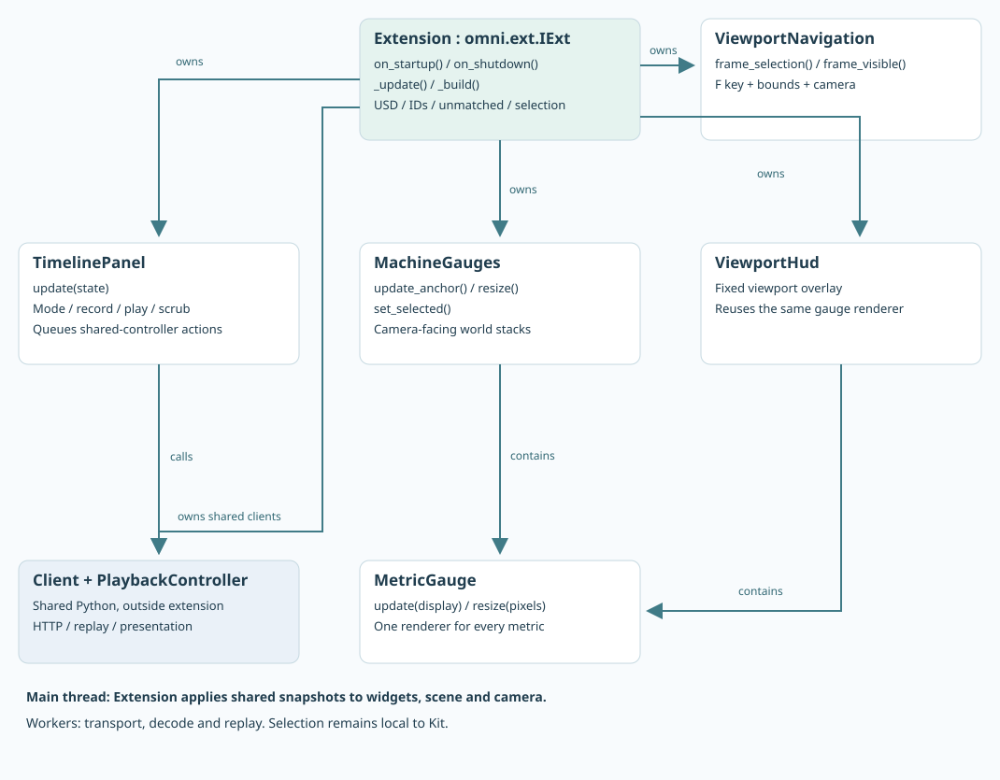

# Kit extension: presentation only

Kit uses the shared Python client and replay engine. Its extension loads a prebuilt USD scene and adds local selection, gauges, table and timeline. It does not contain network adapters, alarm evaluation, aggregation or JSONL parsing.


## Start and interact

Start the service, then run `./run-kit.sh` on the same Linux GPU host. The launcher finds Kit under `~/src/kit`; set `KIT_ROOT=/path/to/kit` or `KIT_EXECUTABLE=/path/to/kit` for another installation. `CB_REFERENCE_CLIENT_CONFIG` selects an alternative reader credentials file.

On Windows, start the Python service and run `.\run-kit.bat` from PowerShell. It uses a sibling `kit` directory by default. For a different SDK, set `$env:KIT_ROOT = "C:\path\to\kit"` before launching. The same application file and extension are used on both platforms. [Windows screenshot with voltage added](../../artifacts/reference/kit-windows-voltage.png).

Select a tube to show its gauges. Selecting the production-line base or an ancestor shows both machines’ gauges. Ctrl-click supports multiple selections; clearing selection hides world gauges. Press F while the pointer is over the viewport to frame the selection. The line throughput HUD stays fixed at the upper left.

The Metric / Value / Status columns remain aligned as numbers change. Temperature is closest to the machine, pressure above it, and voltage is added on top. Gauge rendering is reused for every configured metric, with values and units rather than percentage text.

## Classes and responsibilities



| Module | Kit-specific work |
| --- | --- |
| [__init__.py](../../source/clients/extensions/utils/omni.example.reference_client/omni/example/reference_client/__init__.py) | Extension lifecycle; starts/stops shared clients; loads the prebuilt USD and constructs the panel; applies snapshots on Kit updates; resolves bindings and local selection. |
| [gauges.py](../../source/clients/extensions/utils/omni.example.reference_client/omni/example/reference_client/gauges.py) | `MetricGauge` ring/value/state renderer; `MachineGauges` anchors camera-facing stacks; `ViewportHud` reuses gauges with a fixed screen-space camera. |
| [navigation.py](../../source/clients/extensions/utils/omni.example.reference_client/omni/example/reference_client/navigation.py) | F-key action, bounds and camera framing including gauge extent. |
| [timeline.py](../../source/clients/extensions/utils/omni.example.reference_client/omni/example/reference_client/timeline.py) | Mode dropdown, recording toggle, capture picker, play/pause and scrub controls. Calls shared APIs; performs no disk/network work. |
| [scene_colors.py](../../source/clients/extensions/utils/omni.example.reference_client/omni/example/reference_client/scene_colors.py) | Composes transient cylinder color opinions in a private anonymous session sublayer; skips unchanged colors and cleans up its own layer. |

The live reader, replay worker and catalog worker run in shared Python. Kit’s main thread reads small snapshots, rebuilds widgets when layout changes and updates their values. Scene notices mark binding/bounds data dirty rather than traversing the stage for every measurement. The extension's own color-only notices do not invalidate that cache.

The cylinders use a continuous blue-to-red pressure gradient, with gray for missing values or a disconnected live client. Gauge alarm states remain independent. The [scene-color guide](SCENE_COLORS.md) shows palette reloads, the temporary composition layer, cleanup and performance limits. Color edits are in memory and do not save the USD file; changing a color still has USD/renderer update costs.

## USD binding and selection

Kit loads [assets/production-line.usda](../../assets/production-line.usda) through `Extension._load_scene()`. Geometry, lights, camera and the three source-issued IDs are already authored in that file. The extension reads `assetInfo.sourceIds.<source>.id` and matches both the issuing system and ID to the catalog. It does not mint IDs, construct geometry or write binding metadata at runtime.

Picking a mesh walks to its bound parent; selecting a parent includes bound descendants. This is client lookup logic, not USD metadata inheritance. Selection stays local and transient. Gauge offsets and scale in view configuration affect presentation only. Loading and scrubbing telemetry do not reload the stage.

To use another already-bound scene, pass this setting to either launcher:

```text
--/exts/omni.example.reference_client/stageFile=/absolute/path/to/factory.usd
```

Use a Windows path on Windows. The customer owns the identity assignment and scene-publishing process. See [authoring asset info](USD_BINDINGS.md) for the exact metadata and an idempotent Python example. There is no separate prim-to-asset mapping JSON in this sample.

## Recording and timeline


Mode is on the left; Record is on the right and becomes a red Stop recording button during capture. In Capture replay mode, the capture picker and timeline appear. Play/Pause sits beside the slider; the selected clock is centered inside it, with lighter-gray read-only start/end fields. Live mode hides playback controls. Captures are discovered automatically.

The service records all bindings; the selected prim only controls gauge visibility. Incoming live data continues independently while this Kit client scrubs or plays a file. The console remains live.

## What makes this runnable in Kit?

[apps/reference.kit](../../apps/reference.kit) supplies the application and viewport dependencies. [extension.toml](../../source/clients/extensions/utils/omni.example.reference_client/config/extension.toml) declares UI/scene, USD, viewport, selection, commands, actions and hotkeys; it exposes the repository’s shared Python package to Kit. [run-kit.sh](../../run-kit.sh) wires SDK extension paths and the generated client credentials path. Move the whole project together.

To integrate into an existing Kit app, add this extension path and configure its `clientConfig` setting, then set `stageFile` to your pre-authored scene. The sample opens that scene on startup, replacing the active stage; integrate its loading behavior with your own application lifecycle. Reuse the shared client and gauge classes while keeping your existing scene/identity lifecycle under your application’s control.

Capture replay is a replay of this sample's stream capture, not source history. A history integration would query the issuing system through its source ID and a time range; that path is not implemented here. The [tutorial screenshot](../../artifacts/reference/kit-recorded.png) shows the current Capture replay controls and cylinder colors.

An authored source ID that is missing from the active catalog appears as **UNMATCHED** with its system, ID and a selection button. A prim with no source ID is unbound. Scene and catalog changes trigger rematching; a source ID may be shared by multiple prim placements.
