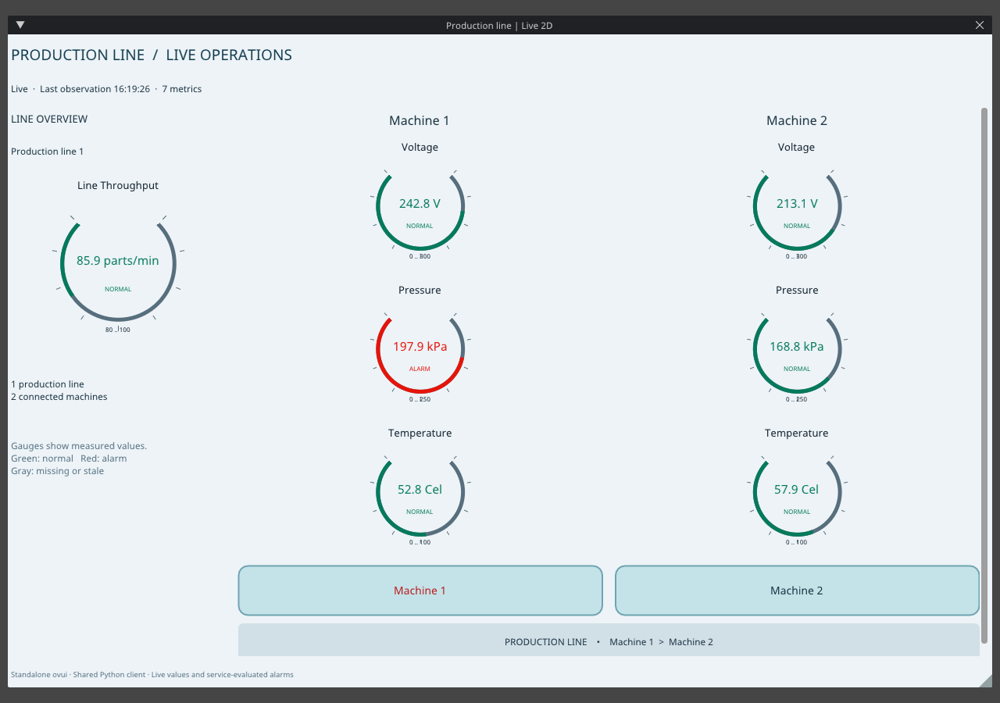
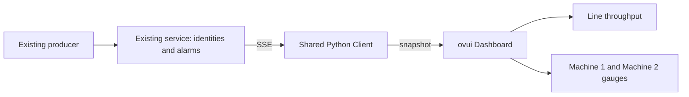

# Standalone 2D client

This optional third client shows the same production line, machines, numeric gauges and alarm states as the Kit sample in a flat ovui dashboard. It uses **ovui 0.2.0**, a standalone UI library. It requires no Kit, USD or OVRTX runtime. It is live-only: no recording, history or timeline controls.



## Start on Linux

Use Python 3.12 and an NVIDIA GPU with a working desktop and driver. The original service and console remain standard-library-only; the following dependencies belong to this optional UI environment.

```bash
python3.12 -m venv .venv-ovui
.venv-ovui/bin/python -m pip install -r requirements-ovui.txt
```

Start the existing service, or leave an already running service in place:

```bash
python3 reference.py demo --no-console
```

In another terminal:

```bash
OVUI_PYTHON="$PWD/.venv-ovui/bin/python" ./run-ovui.sh
```

The console, Kit and ovui clients can all remain open together. Each has its own SSE subscription to the same service. To use another connection configuration, append `--client-config /path/to/client.json`. Do not share that credential file publicly.

## Start on Windows

Use Python 3.12 and a GPU desktop session. In PowerShell, from the sample folder:

```powershell
py -3.12 -m venv .venv-ovui
.\.venv-ovui\Scripts\python.exe -m pip install -r requirements-ovui.txt
python reference.py demo --no-console
```

Leave an existing service running instead of starting a second one. In another PowerShell window:

```powershell
.\run-ovui.bat
```

The launcher defaults to `.venv-ovui\Scripts\python.exe`. Set `$env:OVUI_PYTHON` to use another isolated Python 3.12 environment. The application registers the wheel's native DLL directories on Windows; it does not use libraries from Kit.

## Try live changes

```bash
python3 reference.py configure --add examples/voltage
```

Voltage appears above the existing machine gauges automatically. Edit the thresholds in `examples/default/rules.json` to change alarm conditions for new readings. The service watches configuration, computes alarms, and sends updated results to every client; the UI does not calculate its own thresholds.

Return to the original metric set with the existing configuration command:

```bash
python3 reference.py configure --set examples/default
```

All gauges remain visible in this 2D overview. The left card shows line throughput; the two machine columns show temperature closest to each machine, pressure above it, and newly added metrics above those. Numbers are measured values, not percentages. Green means normal, red means alarm, and gray means missing or stale. The range endpoints are gauge limits, not alarm thresholds.

## Implementation

- `source/clients/ovui_client/app.py`: optional adapter, standalone UI startup, dashboard layout and one reusable vector gauge class.
- `source/clients/ovui_client/__main__.py`: package entry point; the application imports `composable_bindings.reference.client.Client` through an absolute import.
- `run-ovui.sh` and `run-ovui.bat`: Linux and Windows launchers; choose the isolated interpreter with `OVUI_PYTHON`.
- `requirements-ovui.txt`: optional UI dependencies. The CUDA runtime is needed by the ovui wheel even for this 2D surface.
- The existing `reference.client.Client` owns connection/reconnection, event decoding, identity routing and formatting on its worker thread. `Client.snapshot()` supplies display rows. The 2D application imports the shared library; it contains no Kit, USD or OVRTX code. The root launcher uses `python -m clients.ovui_client`.



The UI checks snapshots at most 20 times per second, with its frame loop capped at 30 FPS. Gauges update only when values or states change. Structural changes rebuild the layout; normal readings only change existing labels and arcs. There is no USD stage, native-ID lookup, independent producer or historian in this client.

The production-line grouping follows display placement: a binding with a `hud-top-left` display is shown as a line overview. That is a sample convention, not a general factory hierarchy resolver. The two-machine layout is intended for this demo, rather than a facility-scale dashboard. The client retains the existing service's local demo authentication and transport limitations; see [Architecture](ARCHITECTURE.md).
