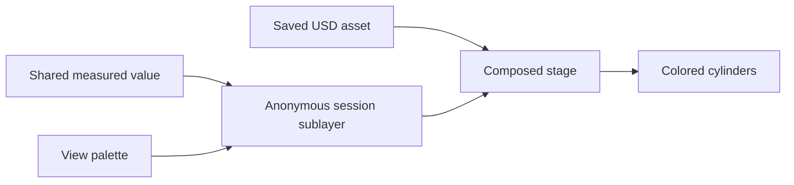
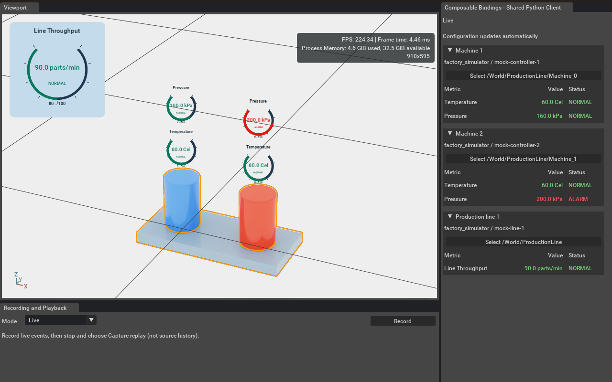

# Live cylinder colors without saving the scene

The default Kit scene colors each cylinder with a continuous pressure gradient: blue at 160 kPa, red at 200 kPa, and linear RGB interpolation between them. Values outside the range clamp to its endpoints. Missing measurements or a disconnected live client use gray. The gauges independently show source/service alarm decisions; a gradient color does not declare an alarm. Colors remain visible when the cylinder is not selected. Capture replay uses the recorded readings and palette.





[Intermediate colors at 180 and 190 kPa](../../artifacts/reference/kit-gradient-midpoints.png) show different cylinder colors while both pressure gauges remain NORMAL.

## Try it

Run the service and Kit as in the [tutorial](TUTORIAL.md). The simulated pressure varies from 160 to 200 kPa, so the cylinders move through the gradient as readings arrive at 2 Hz. The gradient is a continuous mapping of value to color; the sample does not animate invented intermediate readings between source events. The source USD file does not need any edits.

Each machine's `scene` entry in `examples/default/view.json` opts into color presentation:

```json
{
  "source": "factory_simulator",
  "id": "mock-controller-1",
  "display_color": {
    "mode": "gradient",
    "metric": "equipment.pressure",
    "range": [160, 200],
    "colors": {
      "low": [0.05, 0.2, 0.9],
      "high": [0.9, 0.05, 0.02],
      "unknown": [0.3, 0.3, 0.3]
    }
  }
}
```

The palette contains linear RGB components in the range 0–1. Change `high` to `[0.05, 0.8, 0.1]` and high-pressure readings blend toward green on the next view reload. Change `range` to adjust the visual scale independently of the gauge range or alarm threshold. This changes presentation, not alarm policy. A color metric must belong to that source/ID pair; it need not have a visible gauge. Remove `display_color` to reveal the asset's original color. Restore the entry to enable the overlay again.

For discrete alarm colors, the optional `mode: "state"` uses `normal`, `alarm` and `unknown` colors and no `range`. The default uses the value gradient.

Use the service's active configuration directory and pass its `--state` when running commands. A run using a private copy of the configuration is independent of `examples/default`.

## How the composition works

`SceneColors` attaches its own anonymous sublayer under the stage's session layer. It authors only constant `primvars:displayColor` and blocks any weaker color indices. The saved geometry and original authored colors remain in the asset layer. Removing this private layer exposes those original opinions; other session-layer edits are preserved. The extension never changes the user's edit target, calls `Save`, reloads the scene or writes the asset file.

This uses USD composition in memory. Session layers precede the root layer in the stage's layer stack, and ordinary `UsdStage.Save()` excludes session layers and their sublayers. Explicitly flattening/exporting a stage can include the composed result; do not use that operation to save transient presentation. See the [OpenUSD stage API](https://openusd.org/release/api/class_usd_stage.html).

Targets are the renderable descendants of each bound assembly, stopping at nested assemblies with their own source IDs. All placements of a source entity are supported. A target with conflicting configured color owners is skipped with a diagnostic. Instance-proxy geometry is not edited, and a material that ignores `displayColor` will not respond to this overlay. The sample's cylinder meshes have no such material binding. This is a presentation override, not a general material-authoring system.

## Cost and update behavior

- Target discovery happens when bindings or scene structure change, not for each reading.
- The client coalesces readings into its latest presentation snapshot. Only a changed float32 RGB value causes a USD default-value write; there are no time samples accumulating in the layer.
- Changes are batched with `Sdf.ChangeBlock`, using only Sdf operations inside the block. Color notices do not trigger the extension's binding/bounds rescan. See the [OpenUSD change-block guidance](https://openusd.org/release/api/class_sdf_change_block.html).
- Palette changes reuse existing gauge widgets. Removing the policy or shutting down removes the transient opinions.

Avoiding disk writes and repeated USD edits reduces work; it does **not** eliminate USD change processing or renderer updates when a color changes. This demonstration uses two cylinders at 2 Hz, so a changing gradient can author up to two color updates per cylinder per second. It performs more writes than a discrete alarm palette. It is not a throughput benchmark or a claim of zero performance impact. A large, rapidly changing deployment needs measurements with its own assets and renderer.

The focused OpenUSD tests verify composition, unchanged asset bytes, unchanged edit target, no notices for repeated colors, stale-state coloring, nested ownership, conflicting owners and restoration on cleanup. They require OpenUSD Python; run them inside Kit when the system Python has no `pxr` module.

The local Kit check passed all 13 tests and rendered both gradient endpoints, intermediate values and missing-value gray. Thirty repeated live events produced zero additional color writes; swapping the two cylinders' endpoint values produced two writes. A palette reload preserved gauge widget instances, removing the policy restored the asset colors, and the source file's SHA-256 stayed unchanged. These are checks of the update behavior, not a frame-time benchmark.
