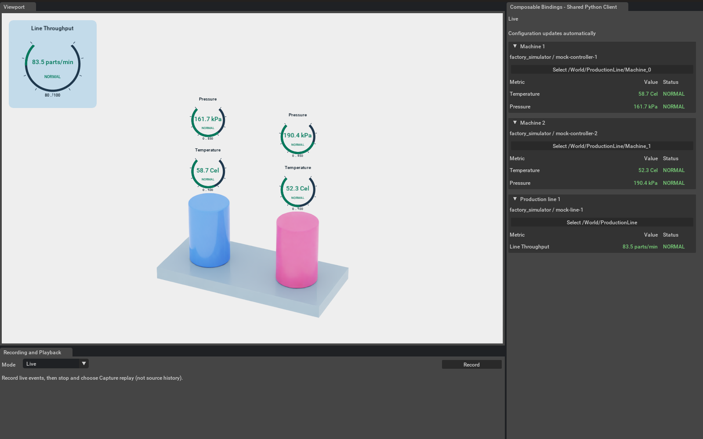
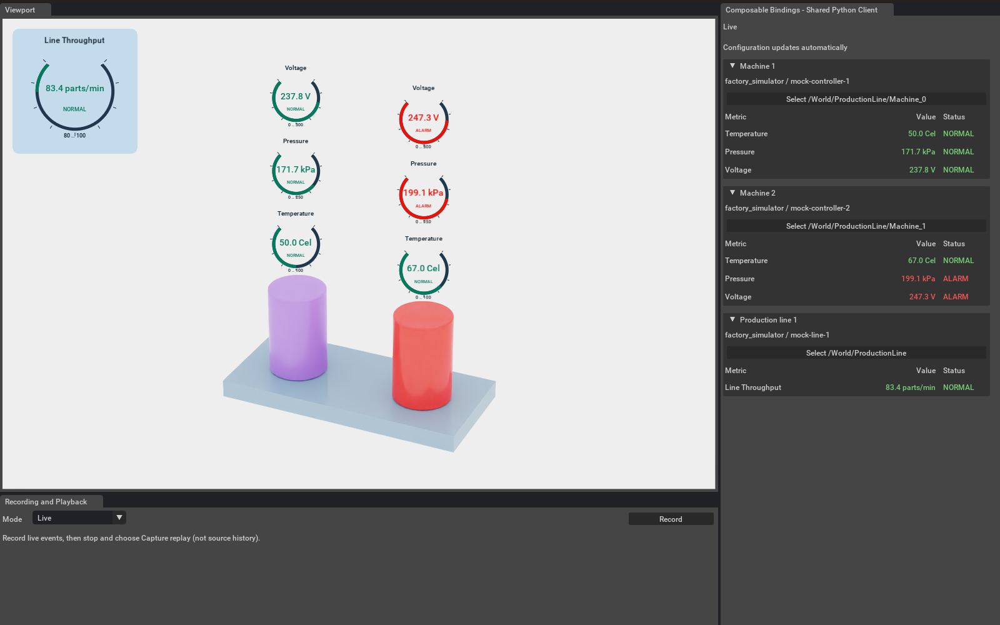
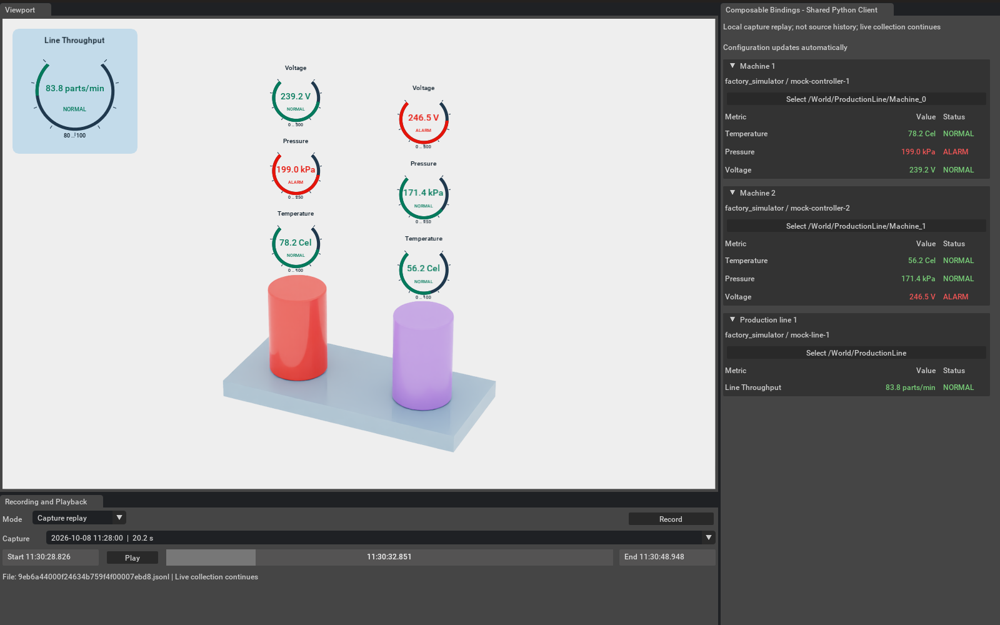

# Tutorial: run the full demo

Allow about 15 minutes. You will start the console and Kit clients, optionally add a standalone 2D ovui client, add voltage without changing Python code, modify measurements and alarms, then record and scrub a capture.

## 1. Prepare the checkout

Use Python 3.9+ on Linux or Windows. The console needs only the standard library. Kit requires a suitable GPU and an already installed Kit SDK. Use the same host for service, console and Kit; the default HTTP adapter is loopback-only.

```sh
cd ~/src/composable-bindings-reference-sample
python3 --version
python3 reference.py validate
```

Use your extracted folder’s actual path if different. Change into it in every terminal. The service and console require no pip install or database setup. Only the optional ovui application needs a separate Python environment.

## 2. Start service and clients

```sh
# Terminal 1 — leave running
./run-services.sh
# Terminal 2 — same project directory
python3 reference.py console
# Terminal 3 — Linux GPU host
./run-kit.sh
```

For another SDK location, use `KIT_ROOT=/path/to/kit ./run-kit.sh`. The service starts the default producer, listens on port 9861 and creates private reader/producer credentials. Every connected client receives the same event occurrences. For a shell-only introduction, `./run-default.sh` combines the producer, service and console.

**Expected:** two cylinders share a production-line platform. Their colors follow live pressure readings through a blue-to-red gradient over 160–200 kPa. The panel shows temperature/pressure for each machine and Line Throughput for the line. The shell prints corresponding values and alarm states. Select the production-line base to show both machines' world gauges, as in the screenshot.



On Windows, use PowerShell terminals and native Python for the service and console (no WSL):

```powershell
cd C:\src\composable-bindings-reference-sample
python reference.py demo --no-console
# In another terminal, from the same folder:
python reference.py console
# In a third terminal, start Kit:
.\run-kit.bat
# In another terminal, add voltage while both keep running:
python reference.py configure --add examples/voltage
```

Use `python` instead of `python3` for subsequent commands on Windows. The `.sh` launchers are Linux conveniences.

Kit opens [the prebuilt USD scene](../../assets/production-line.usda), which already contains the three asset-info bindings. No geometry generation or binding setup command is needed. To use your own scene, follow [USD binding authoring](USD_BINDINGS.md), then pass `--/exts/omni.example.reference_client/stageFile=/absolute/path/to/factory-bound.usda` to the Kit launcher.

### Optional: add the 2D ovui client on Linux

With Python 3.12 available, create its isolated environment once:

```sh
python3.12 -m venv .venv-ovui
.venv-ovui/bin/python -m pip install -r requirements-ovui.txt
OVUI_PYTHON="$PWD/.venv-ovui/bin/python" ./run-ovui.sh
```

This opens a 2D production-line overview using the same service, with no Kit dependency. All machine gauges are visible; line throughput has its own card. Adding voltage and changing thresholds below updates all three clients. See [the ovui guide](OVUI.md) for details. Console and ovui stay live while Kit plays a recording.

## 3. Explore selection and gauges

Select a tube to show its gauges. Ctrl-click selects multiple machines; clearing selection hides them. Select the production line or its base to show both sets. Press F with the pointer over the viewport to frame the selection. The throughput HUD stays at the upper left regardless of camera movement.

Cylinder colors remain visible with no selection. Temperature is the gauge closest to each cylinder; pressure is above it and controls the default cylinder color. Gauge alarm states are evaluated independently of the color gradient.

## 4. Add a new event and display

In a fourth terminal:

```sh
python3 reference.py configure --add examples/voltage
python3 reference.py configure --status
```

**Expected:** voltage appears in every connected client without a restart. In Kit it sits above pressure on selected machines. The line keeps its single throughput gauge.



Open `examples/voltage/view.json`, change `"kind": "gauge"` to `"kind": "label"`, and save. The voltage ring disappears while the value remains; the console stops drawing its text bar. Restore `gauge`. This demonstrates an added event and a different supported display using JSON only.

## 5. Change the data and alarm threshold

Open `examples/default/simulation.json`. In the temperature simulation, change `center` from 65 to 70, leaving the rest intact. Save and watch subsequent readings move around the new center. Restore 65 afterward. Change `period` to change the fluctuation speed; `interval` controls emission frequency.

Open `examples/default/rules.json` and change the temperature entry’s `threshold` value from 100 to 65. Keep the pressure rule. Save: new temperature readings now alternate between NORMAL and ALARM in every connected client. Restore 100: the new readings clear. Recorded alarms are not rewritten.

```json
{"metric": "equipment.temperature", "threshold": 65}
```

The cylinders also follow **pressure values** through a continuous blue-to-red gradient in a temporary USD composition layer. The default range is 160–200 kPa; alarm decisions remain on the gauges. Edit each machine's `display_color.range` or `display_color.colors.low` / `high` in `view.json` to change the visual mapping live. The saved scene stays unchanged. See [cylinder colors](SCENE_COLORS.md) for the composition mechanism and performance limits.

To try **cylinder colors based on temperature**, change each machine's `display_color.metric` to `equipment.temperature` and its `display_color.range` to `[50, 80]` in `examples/default/view.json`. The cylinders then follow temperature readings over 50–80 Cel; gauge ranges and alarm thresholds stay independent. Restore `equipment.pressure` and `[160, 200]` afterward to return to the default appearance.

`configure --status` reports rejected edits. Invalid service configuration retains the last valid revision. Simulation errors are reported by the producer. For appearance, try changing a gauge title or scene `gauge_scale` in the view file; these also update live.

## 6. Capture and replay the live stream

This demonstrates a local stream capture. Source history would be fetched from the issuing system using its source-issued ID and a time range; this sample does not implement that query.

Click **Record** on the right of Kit’s bottom panel. It turns red and becomes **Stop recording**. Let the demo run for 20–30 seconds; optionally add/remove voltage or change a rule during the capture. Click the same button to finish.

Choose **Capture replay** in the Mode dropdown on the left. The capture picker and playback controls appear; select the desired capture. Drag the slider or use Play/Pause beside it. The slider shows the selected clock time, including milliseconds; lighter-gray read-only fields show the start and end. The table, machine gauges, cylinder colors and line HUD follow that recorded instant, using the captured view configuration.



Choose **Live** to return to current readings and hide playback controls. The console and optional ovui dashboard have stayed live throughout. Recordings contain all bindings; selecting a machine affects visibility, not what is captured.

## 7. Reuse a recording

Finished captures live in `.runtime/default/recordings/*.jsonl`. Copy a finished file, keeping its generated name, into another installation’s recording folder. Start that service and Kit; the list updates automatically. Do not copy credentials or unfinished `.part` files.

Capture uses JSON Lines and no extra packages. It stores an initial snapshot, public event/configuration packets and a footer. Stop normally to finalize the file. Captures are capped at 64 MiB; queue/disk failures and incomplete files are surfaced rather than silently replayed as complete history.

## 8. Add a different source

Follow the [second-source guide](SOURCES.md) to add `examples/line_gateway` and run its JSON adapter. It provides its own source IDs and alarm decisions, with no simulator settings and no service code changes. The fixtures are synthetic; use a verified payload mapping for actual Delta CL6 data.

## 9. Reset and stop

```sh
# Remove only the voltage fragment.
python3 reference.py configure --remove examples/voltage
# Or clear all additions and select the default base.
python3 reference.py configure --set examples/default
```

`--set` does not restore JSON edits, so restore any thresholds, simulation values or display changes yourself. Close Kit; use Ctrl-C in the console and service terminals. Console shutdown does not stop an independent service. A fresh start uses default without additions.

## Troubleshooting

| Symptom | Check |
| --- | --- |
| Address already in use | A service already uses that port. Reuse it, or choose another `--state` and `--port`. |
| Kit cannot find credentials | Start services first. For custom state, set `CB_REFERENCE_CLIENT_CONFIG=/path/to/state/client.json`. |
| Mode dropdown disabled | There is no completed capture yet. Record and stop first. |
| No world gauges | Select a machine or production-line parent. Check for an UNMATCHED source-ID card; a prim without an ID is unbound. |
| Playback controls absent | They appear only in Capture replay mode. |
| Values stay unchanged after editing | Check the active base/additions with `configure --status`, then edit those original files. |
| Connection is stale | Check the service process and credentials path. The client reconnects; the simulator may need a restart after a prolonged transport failure. |

## Validate the configuration

```sh
python3 reference.py validate
```

Use `python` on Windows. Read [the architecture](ARCHITECTURE.md) for limitations and what to replace when moving to real operational data.
